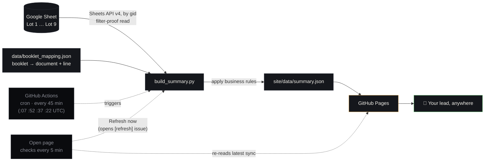

<div align="center">


<br>

[](https://github.com/vikramdex-ops/iso-review-dashboard/actions/workflows/deploy.yml)
[](https://vikramdex-ops.github.io/iso-review-dashboard/)


[](LICENSE)
[](https://github.com/vikramdex-ops/iso-review-dashboard/stargazers)
[](CONTRIBUTING.md)

<br>

### 🔗 [**Open the live dashboard →**](https://vikramdex-ops.github.io/iso-review-dashboard/)

<sub>`vikramdex-ops.github.io/iso-review-dashboard` — bookmark it, no login needed</sub>

</div>

<br>

<p align="center">
  <a href="#what-this-is">What this is</a> ·
  <a href="#how-it-stays-current">How it stays current</a> ·
  <a href="#the-rules-behind-the-numbers">The rules behind the numbers</a> ·
  <a href="#on-the-dashboard">On the dashboard</a> ·
  <a href="#project-layout">Project layout</a> ·
  <a href="#adding-another-lot">Adding a lot</a> ·
  <a href="#faq">FAQ</a>
</p>



<br>

> **Picking this project up fresh, in any Claude account or AI assistant?** Read
> [`HANDOFF.md`](HANDOFF.md) first — full architecture, business rules, secrets setup (no values),
> known bugs/fixes, and current status in one place.

## What this is

A single static page that always shows the current state of the ISO review register — who owns what, how much is closed, open, or on hold, split by severity and by lot, with a combined cross-lot view per reviewer. No one touches the Google Sheet export manually, no one re-runs a script, no one pushes code to refresh it. A scheduled job in GitHub Actions does that every 45 minutes — on GitHub's servers, so nobody's PC needs to be on — and a page left open picks up each new sync on its own within 5 minutes (or on demand with **Refresh now**, which runs a fresh sync from the sheet in about 1–2 minutes).

The sheet stays the single source of truth. This repo only mirrors it, honestly, into something a lead can glance at.

<table align="center">
<tr>
<td align="center" width="25%">

**📋 9 Lots**
<br><sub>Lot 1 – Lot 9, same rules</sub>

</td>
<td align="center" width="25%">

**⏱ Every 45 minutes**
<br><sub>cloud cron, no PC needed</sub>

</td>
<td align="center" width="25%">

**🧮 Zero guesswork**
<br><sub>rules applied mechanically</sub>

</td>
<td align="center" width="25%">

**🪵 Fully auditable**
<br><sub>every sync is a git commit</sub>

</td>
</tr>
</table>

<br>

## Who this is for

The rules in this repo are specific to one ISO review register, but the shape of the problem isn't: **"I have a Google Sheet someone updates, and I need a live status page for people who shouldn't need sheet access."** Status trackers, intake logs, review registers, punch lists — anything where the sheet is the real database and a dashboard is just the window into it.

If that's your situation, the parts worth taking are:

- a sync script that reads tabs by numeric `gid` (not name — Google silently swaps tabs on a name mismatch, see [`build_summary.py`](scripts/build_summary.py))
- a content-hash guard against accidentally reading the same tab twice
- an all-or-nothing sync so a bad fetch never overwrites a good dashboard
- a GitHub Actions workflow that does the fetch → commit → deploy loop on a schedule, for free, with no server

Swap the column mapping and keyword rules for your own sheet's shape (see [Adding another lot](#adding-another-lot) and [`CONTRIBUTING.md`](CONTRIBUTING.md)) and the rest holds.

<br>

## How it stays current



**When it runs.** Every 45 minutes, at 00:07, 00:52, 01:37, 02:22 UTC and so on (05:37, 06:22, 07:07 … IST), plus on every push, on demand (`workflow_dispatch`), and whenever someone clicks **Refresh now** on the page (it opens a `[refresh]` issue that the workflow picks up, syncs, deploys and closes). The times sit 7 minutes off the quarter-hour on purpose: GitHub delays or skips scheduled runs most often at :00/:15/:30/:45, when every repository's cron fires at once. GitHub does not guarantee scheduled runs, so on a busy day an occasional slot can still be skipped — the next one catches up, and nothing is lost because each run reads the whole sheet.

Every run is guarded, not best-effort:

- **Filter-proof reads via the Sheets API** — when `GOOGLE_SHEETS_API_KEY` is set (recommended, see below), each tab is read through the Google Sheets API v4 rather than the public CSV export. The API returns a tab's real values regardless of any active `Data > Create a filter` on it, so a reviewer who's mid-filter on the live sheet never causes a dip in the dashboard's count. Falls back to the CSV export (which a live filter *can* hide rows from) when the key isn't configured, e.g. for a quick local run.
- **Fetched by numeric tab `gid` only** — never by sheet name, which Google silently substitutes with the wrong tab on a mismatch.
- **Content-hash checked across lots** — if two lots ever fetch byte-identical content, the run fails loudly instead of quietly duplicating a lot.
- **Row-count regression guard** — if a lot's row count ever drops versus the last sync, that lot's read is rejected and the previous known-good data is kept for just that lot, with the reason shown on the dashboard. (On the CSV path this usually means a filter; on the Sheets API path it means something was actually deleted or restructured — either way it's surfaced instead of silently under-counting.)
- **All-or-nothing per sync** — if any lot can't be read, the previous deployed site is left untouched rather than publishing partial numbers.
- **The sync itself is committed back to the repo** (`site/data/summary.json`, `closed_log.json`) — every number on the dashboard is auditable against real git history, not a black box.

<details>
<summary><b>Setting up filter-proof reads (<code>GOOGLE_SHEETS_API_KEY</code>)</b></summary>
<br>

1. In [Google Cloud Console](https://console.cloud.google.com/apis/library/sheets.googleapis.com), enable the **Google Sheets API** for a project (any project; no billing needed for this read-only, low-volume use).
2. Create an **API key** ([Credentials](https://console.cloud.google.com/apis/credentials)) and restrict it to the Google Sheets API only — no need to restrict by IP/app, since this key only grants read access and the sheet is already link-shared.
3. In this repo: **Settings → Secrets and variables → Actions → New repository secret**, name it `GOOGLE_SHEETS_API_KEY`, paste the key.
4. Re-run the workflow (`workflow_dispatch`, or just wait for the next cron) — the sync log will show `fetch_method: sheets_api` instead of `csv_export`, and the dashboard's sheet-check line will say "filter-proof read".

Without this secret, the dashboard still works via the public CSV export — it's just vulnerable to a team member's active filter hiding rows from that one sync (automatically recovered on their next sync once the filter is cleared, since the previous known-good number is kept in the meantime).
</details>

<br>

## The rules behind the numbers

Everything the dashboard shows is derived mechanically from the sheet — no manual tagging.

| Rule | Logic |
|---|---|
| **Who owns a comment** | Column **P** (`Assigned To`). If two names appear separated by `/`, the **later** name is the actual assignee. |
| **Severity** | Column **M** (`Severity`) — High / Medium / Low. |
| **Closed / Completed** | Column **N** (`Status`) = `Closed`, **or** column **Q** (`Modeller response`) contains *updated, completed, done, ignored,* etc. — even while Status still reads Open. |
| **On Hold** | Column **Q** contains `RDB` or `HOLD`. |
| **Open** | Anything not matched above. |
| **Completed Today / Yesterday** | A persisted first-seen-closed log timestamps each row the moment it's first observed closed (IST calendar day), so "today's" closures are exact — not a quirk of when the sheet happened to update. |

<br>

## On the dashboard

Three screens, one page:

**Summary**
- **Overview strip** — total assigned, closed, open, on hold, at a glance before anything else.
- **Per-lot breakdown** — Lot 1 through Lot 9, filterable by chip, each row keyed by reviewer.
- **Combined (by person)** — the same reviewer's numbers rolled up across *all nine lots* in one line, for when lot boundaries don't matter and ownership does.
- **Severity ledger** — proportional High / Medium / Low bars per person.

**Issuance** — per document: ready to issue (every comment closed), "address these" (≤3 points left) or "needs more work", with **Mark as issued** to record a batch that has gone out.

**Booklet Issuance** — readiness of each ISO booklet, **counted by document, not by comment**:
- a document is *closed* once every comment against it, in every lot, is closed; *open* while any comment is open or on hold; *not yet in any lot* when no lot has reviewed it;
- a booklet is *ready to issue* only when all of its documents are closed;
- the four demolition booklets (01-15-1913, 01-15-1914, 39-15-1677, 39-15-1678) are excluded from issuance;
- a **document tracker** lists every booklet document with its line(s), status, open/total comments, lots and extraction-plan status — filter by status or booklet, search, and copy the list to chase what's outstanding.

**Everywhere**
- **Stays current while open** — the page re-reads the published sync every 5 minutes and whenever its tab comes back into view; **Refresh now** runs a real sync from the sheet straight away and shows the result as soon as it lands (usually 1–2 minutes).
- **Sheet reconciliation line** — states plainly how many rows were read vs. counted vs. excluded, so a mismatch is visible, not hidden.

<details>
<summary><b>Full column set (19 columns per row)</b></summary>

<br>

`Assigned To` · `Lot Category` · `Assigned/Closed/Open — High` · `Assigned/Closed/Open — Medium` · `Assigned/Closed/Open — Low` · `Hold — High/Medium/Low` · `Overall Total Assigned` · `Overall Closed` · `Overall Open` · `Completed Today` · `Completed Yesterday`

</details>

<br>

## Project layout

```
iso-review-dashboard/
├── config.json                  # sheet id, lot → gid map, status keywords
├── data/
│   └── booklet_mapping.json      # booklet → document + line (built from the mapping workbook)
├── scripts/
│   ├── build_summary.py          # fetch → apply rules → write summary.json (runs every sync)
│   ├── build_booklet_mapping.py  # offline: mapping workbook (.xlsx) → data/booklet_mapping.json
│   └── apply_issued.py           # records "Mark as issued" batches into issued_log.json
├── site/
│   ├── index.html                # the dashboard itself (single file, no build step)
│   └── data/
│       ├── summary.json          # latest synced snapshot (committed every run)
│       ├── closed_log.json       # per-row first-closed date, for day-aware counts
│       └── issued_log.json       # documents marked as issued
└── .github/workflows/
    ├── deploy.yml                # cron (every 45 min) + push + manual dispatch + Refresh-now issues → sync → commit → deploy
    └── issue-intake.yml          # "Mark as issued" write path
```

## Updating the booklet mapping

The booklet → document mapping comes from the owner's mapping workbook (currently `FST_ISO_Booklet_Mapping_v3.xlsx`). When a revised workbook arrives:

```bash
pip install openpyxl
python3 scripts/build_booklet_mapping.py FST_ISO_Booklet_Mapping_v3.xlsx
```

It refuses to write if any check fails, and records every decision it applies (owner confirmations, the GRE spec rule, rows the designer marked *Superseded* or *Deleted*) inside the JSON so the dashboard can show them. Commit `data/booklet_mapping.json`; the next sync picks it up.

## Adding another lot

Add one entry to `config.json`, same sheet — either the tab's numeric `gid` (stable even if the tab gets renamed later):

```json
"lots": { "Lot 10": "123456789" }
```

...or, if you don't want to dig the `gid` out of the sheet's URL, point at the tab by its current name instead (looked up automatically via the Sheets API, so it needs `GOOGLE_SHEETS_API_KEY` to be set):

```json
"lots": { "Lot 10": "title:lot-10" }
```

Nothing else changes. The combined view, the chips, and the totals strip all pick it up on the next sync.

<br>

## FAQ

<details>
<summary><b>Does this need a backend, database, or paid hosting?</b></summary>
<br>No. The sync runs in GitHub Actions (free for public repos), the output is one JSON file, and the page is static HTML served by GitHub Pages (also free). The only moving part is the Google Sheet itself.
</details>

<details>
<summary><b>Does my PC need to be on for the dashboard to update?</b></summary>
<br>No. The sync runs in GitHub Actions on GitHub's servers and the page is hosted on GitHub Pages — nothing runs on anyone's computer. If the "Synced … ago" line ever looks old, it is either an open tab from before the latest sync (it now refreshes itself within 5 minutes) or a scheduled slot GitHub skipped on a busy day (the next slot catches up).
</details>

<details>
<summary><b>Does Claude / this repo have write access to my Google Sheet?</b></summary>
<br>No — it only reads each tab's values, either via a restricted, read-only Google Sheets API key or the public CSV export (the sheet must be shared "Anyone with the link → Viewer" either way). Nothing is ever written back to the sheet.
</details>

<details>
<summary><b>What if the sheet structure doesn't match mine?</b></summary>
<br>Edit the column mapping and keyword lists in <code>config.json</code> / <code>scripts/build_summary.py</code> — see <a href="#who-this-is-for">Who this is for</a> and <a href="CONTRIBUTING.md">CONTRIBUTING.md</a>. Nothing else in the pipeline needs to change.
</details>

<details>
<summary><b>Can I self-host this for my own team?</b></summary>
<br>Yes — it's MIT licensed. Fork it, point <code>config.json</code> at your own sheet, and GitHub Actions + Pages do the rest on your own repo.
</details>

<br>

## Built with

<p align="center">
  
  
  
  
  
</p>

<div align="center">
<sub>No server. No database. No vendor lock-in. The sheet stays the source of truth — this is just the window into it.</sub>
</div>

<br>

## Star history

<a href="https://star-history.com/#vikramdex-ops/iso-review-dashboard&Date">
  <picture>
    <source media="(prefers-color-scheme: dark)" srcset="https://api.star-history.com/svg?repos=vikramdex-ops/iso-review-dashboard&type=Date&theme=dark" />
    
  </picture>
</a>

<div align="center">

If the sheet-to-dashboard pattern here saves you from building your own, a ⭐ helps the next person find it.

<br><br>


</div>
